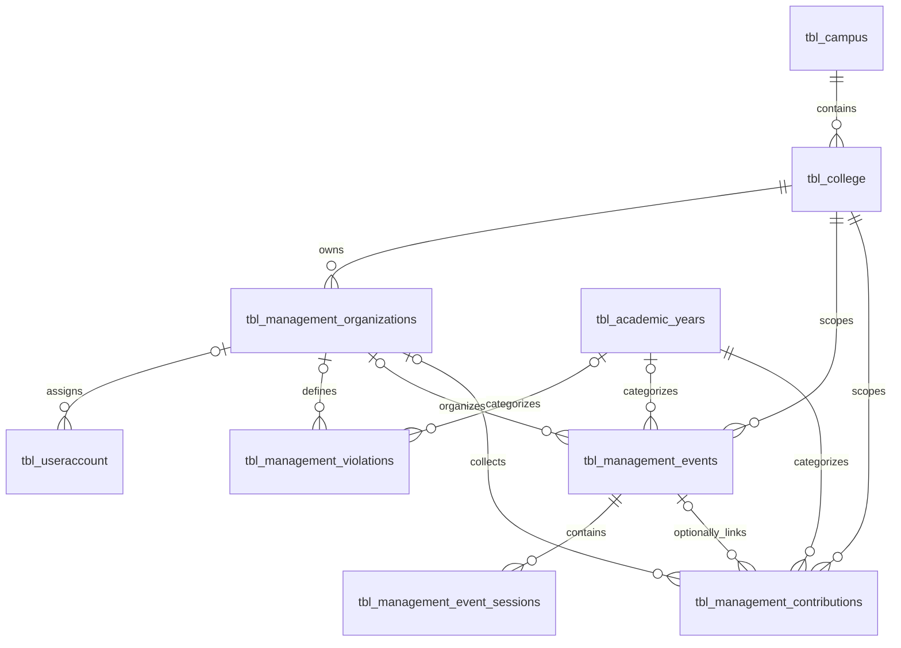

# Management contribution and event catalog

This step imports **definitions only** into the configured Synk database. It does
not copy the old table structures or import payments, student assignments,
exemptions, participants, attendance, accounts, or student profiles. The portal now
supports managing these definitions; collection and attendance capture are separate
future workflows.

The supplied October 26, 2026 dump contains 29 contributions in `tblcontibution`,
7 general events in `tblevent`, and 4 timed events in `tblevents`. These become:

| New table | Initial rows | Purpose |
| --- | ---: | --- |
| `tbl_management_organizations` | 2 | CSSO and PSITS, separately owned by CCS |
| `tbl_management_contributions` | 29 | Contribution definitions and amounts |
| `tbl_management_events` | 11 | One independent event per source event record |
| `tbl_management_event_sessions` | 4 | Schedules and rules belonging to the 4 timed events |

The sessions describe four of the eleven events; they are not four additional
events. Similar titles across the old tables are not automatically merged.

## Managing definitions in the portal

Open `/management/contributions.php` or `/management/events.php`. Both pages provide
title and lifecycle filters, selected-term/all-term/unassigned-term views, and
25/50/100-record pages, strictly within the account's assigned organization.
Each row has Edit and Delete actions, and the page offers Add.

Organization setup is managed exclusively in Administrator → Organizations.
Account assignment follows Campus → College → Organization. One college can own
many organizations, and one organization can have many accounts. Organization
codes are unique within their college. Assignments persist across terms.

Contribution forms manage title, description, date, amount, audience, status, and
an optional event link within the same organization and academic term. Event
forms manage date, status, audience, absence fine, coordinates/radius, and up to
50 named sessions with exact decimal rates, grace periods, reference amounts,
and statuses. Organization and term are assigned automatically: new records use
the account organization and current Academic Settings; edits preserve original
terms. A stale current-term token requires reloading the form. Session additions,
edits, and removals commit atomically with their parent event. Business text is
uppercased on the server; source provenance is preserved.

Deletes require confirmation and the latest record version. Deleting an event
also removes its sessions. An event linked to contributions must first be detached
from those contributions, or archived. Foreign-key restrictions on any future
dependent data also block deletion and roll back the entire request.

`backend/query_management.php` accepts POST requests with a Management-specific
CSRF token and revalidates Google authentication, active role, current assignment,
organization, college, and campus. IDs are checked within the assigned organization.
Writes lock the organization, account assignment, current academic settings, and parent row, and use a content fingerprint including event
sessions to reject stale edits or deletes. Source IDs and checksums are not editable
through these forms. No DDL occurs in page or API requests. Contribution/event CRUD
uses the existing catalog schema.

The separate Violations page uses `tbl_management_violations` for organization/term
violation type/amount definitions. Prepare it with
`php backend/tools/prepare_management_violations.php`, then run
`php backend/tools/prepare_management_organizations.php` to add assignment and term
constraints. No legacy payment, student, or attendance rows are imported. See
[management-portal.md](management-portal.md) for the current-term payment integration contract.

## Relationships and later development



- All records have new auto-increment primary keys. Old IDs are retained only as
  source references; they are never used as Synk primary keys.
- Composite foreign keys enforce matching colleges between organizations,
  contributions, events, and sessions. A different college cannot be attached
  through one of those relationships.
- Academic years use existing `tbl_academic_years.ay_id`; semester is numeric
  (`1`, `2`, or `3`). Existing college, campus, and academic-year values are not
  modified. Campus is obtained through the college.
- The four timed source events have no organization, academic year, or semester.
  Those fields remain `NULL`, awaiting an explicitly approved mapping. They are
  hidden from organization accounts. Dates are not used to guess relationships.
- A contribution's optional `event_id` is initially `NULL`. Later development can
  associate a contribution with an event in the same organization and academic term.
- Future charges, payments, exemptions, and attendance should reference these new
  catalog keys and Synk's `tbl_student_management.student_id`. Eligibility must use
  the college/campus/term memberships in
  `tbl_student_management_enrolled_subjects`. Do not recreate the legacy masterlist
  or attach multiple students directly to a definition row.
- `ON DELETE RESTRICT` prevents deleting referenced parents. Later management
  actions should normally archive a definition rather than delete its history.

## Field mapping and normalization

Contribution `fines` becomes `amount` (`DECIMAL(12,2)`); the source field is a
contribution amount rather than a payment. General event `fines` becomes
`absence_fine`, with the source's geofence coordinates and radius retained.
Timed-event schedules become session start/end datetimes. Fine rates use
`DECIMAL(12,4)`, with exact conversion and no rounding. `potentialfine` becomes a
session reference amount, `potential_fine`; it is not interpreted as a balance,
receipt, assessed charge, or confirmed maximum-fine policy.

Legacy audience `ALL` maps to `ALL`, and `OTHERS` maps to `SELECTED`. The original
audience and general-event `stat` flag are retained in uppercase-keyed JSON
`source_metadata`. They are separate from lifecycle status. Contributions and
general events are initially `DRAFT`, because their source rows provide no reliable
open/closed lifecycle. Timed events and sessions retain source `OPEN`/`CLOSED`.
No charges or attendance processing are activated by importing these definitions.

Business text is Unicode-normalized and stored in uppercase. Reversible
Windows-1252/UTF-8 encoding damage is repaired before normalization. In this dump,
contribution source ID 75 becomes `MITING DE AVANCE`. Other spellings, amounts,
dates, and rule values are preserved, including dates that may need later review.
Organization names initially use the known codes `CSSO` and `PSITS`, without
inventing expanded names.

## Import and verification

Use Node.js 18+ and PHP CLI with `mysqli` and `mbstring`, connected through the
existing ignored `backend/db_config.local.php`. Tables are InnoDB, UTF-8, and
compatible with MySQL 5.7. No source SQL is executed. The extractor recognizes only
the three definition tables and rejects unexpected columns and nonliteral values.
Generated JSON contains catalog definitions only; keep it in ignored local storage.

```powershell
node backend/tools/extract_management_catalog.cjs '<source-dump.sql>' '.tmp/management-catalog-import.json'
php backend/tools/prepare_management_catalog.php '.tmp/management-catalog-import.json'
php backend/tools/prepare_management_catalog.php '.tmp/management-catalog-import.json' --apply
node tests/management-catalog-extract.cjs
php tests/management-catalog.php '.tmp/management-catalog-import.json'
node tests/management-catalog-import.cjs '.tmp/management-catalog-import.json'
```

Extraction refuses to overwrite an existing output file. Validation is read-only
unless `--apply` is supplied. All rows and Synk dependencies are validated before
DDL. Apply runs only the reviewed additive schema in
`backend/sql/create_management_catalog.sql`, then inserts definitions inside one
transaction under a database-specific import lock. MySQL DDL is not transactional;
a failure after table creation may leave empty new tables, but inserted catalog
rows roll back together.

Unique `(college_id, source_table, source_record_id)` keys and uppercase SHA-256
source-row checksums make repeated imports safe. The same source rows are skipped,
preserving subsequent manual edits. A changed source checksum aborts the data
transaction; it does not overwrite existing definitions. Source fields should be
kept read-only in future editing forms. Source references are nullable for native
Synk definitions created later.

Database verification compares every imported definition and session with the
manifest and checks that cross-college foreign-key violations are rejected.
Integrity fixtures are rolled back. The initial import also verified checksums of
all 66 pre-existing Synk tables before and after applying the migration.
The import scenarios verify rejection of invalid text, precision, dates, and
inferred terms, plus rollback after an organization insert and later source
conflict. A repeated apply must insert zero rows and preserve table checksums.
If PHP is not on `PATH`, pass its executable as the optional last argument to the
Node import scenarios.
